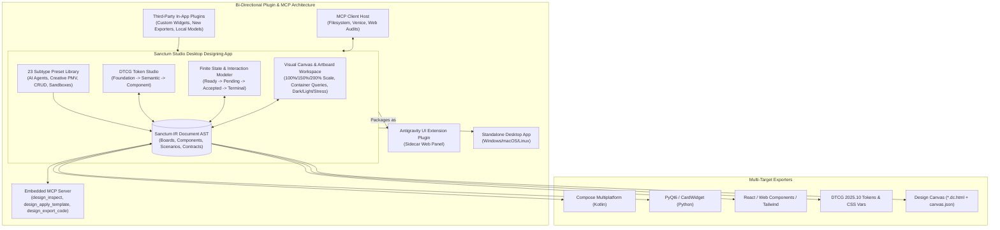
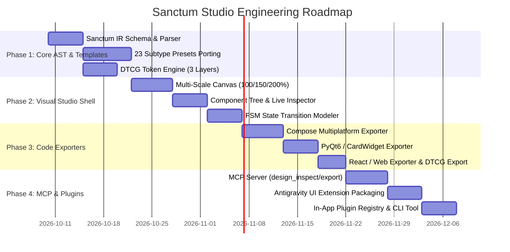

# Sanctum Studio: Desktop Design Application & Agentic Code-Generation Engine
## Architecture, Research & Engineering Blueprint

> **Reference Baseline**: [`docs/design/sanctum-ux/GUIDE_UPDATE_RECORD.md`](file:///mnt/a/New%20folder%20%284%29/white-devil-release-1.0.6/docs/design/sanctum-ux/GUIDE_UPDATE_RECORD.md)  
> **Source Files**: [`DESIGN_PROCESS.md`](file:///mnt/a/New%20folder%20%284%29/white-devil-release-1.0.6/docs/design/sanctum-ux/DESIGN_PROCESS.md), [`INTERFACE_PATTERNS.md`](file:///mnt/a/New%20folder%20%284%29/white-devil-release-1.0.6/docs/design/sanctum-ux/INTERFACE_PATTERNS.md), [`LIBRARY_CATALOG.md`](file:///mnt/a/New%20folder%20%284%29/white-devil-release-1.0.6/docs/design/sanctum-ux/LIBRARY_CATALOG.md), [`PLATFORM_GUIDES.md`](file:///mnt/a/New%20folder%20%284%29/white-devil-release-1.0.6/docs/design/sanctum-ux/PLATFORM_GUIDES.md), [`TOKENS_AND_THEMING.md`](file:///mnt/a/New%20folder%20%284%29/white-devil-release-1.0.6/docs/design/sanctum-ux/TOKENS_AND_THEMING.md), [`VALIDATION_AND_HANDOFF.md`](file:///mnt/a/New%20folder%20%284%29/white-devil-release-1.0.6/docs/design/sanctum-ux/VALIDATION_AND_HANDOFF.md), [`TEMPLATES.md`](file:///mnt/a/New%20folder%20%284%29/white-devil-release-1.0.6/docs/design/sanctum-ux/TEMPLATES.md), [`SANCTUM_CASE_STUDY.md`](file:///mnt/a/New%20folder%20%284%29/white-devil-release-1.0.6/docs/design/sanctum-ux/SANCTUM_CASE_STUDY.md), and `canvas-src/` (`canvas.json`, `Main.dc.html`, `System.dc.html`, `Flows.dc.html`, `NavMap.dc.html`, `Handoff.dc.html`, `QA.dc.html`, and 29 `S-*.dc.html` scenario artboards).  
> **Target Products**: Compose Multiplatform desktop ([`desktop/`](file:///mnt/a/New%20folder%20%284%29/white-devil-release-1.0.6/desktop)), HypnoForge PyQt6 desktop ([`HypnoForge/`](file:///mnt/a/HypnoForge)), Web/Mobile, and Agentic Workflows.

---

## 1. Executive Vision & Core Philosophy

The goal is to translate the static documentation and HTML/CSS canvas files of the Sanctum UX Handbook into **Sanctum Studio**: a high-performance desktop design engineering application. 

Sanctum Studio is not merely another generic drawing tool (like Figma or Sketch). It is an **interactive, contract-driven, code-generating design IDE** built around five uncompromised principles established in the handbook:
1. **Meaning Before Pixels**: Design tokens (DTCG 2025.10) form a strict 3-tier hierarchy (Foundation → Semantic → Component) where layouts are driven by `em`-based units and container queries, guaranteeing resilience under 100%, 150%, and 200% system text scaling.
2. **Contracts & Real States Over Pretty Screens**: Screens are representations of a single underlying Finite State Machine (FSM). A status is never painted as "Completed" when it was only submitted; failure, cancellation, offline, and pending states are first-class citizens.
3. **Preset Subtype Architecture**: Ships with turnkey templates for all **23 interface subtypes** defined in `INTERFACE_PATTERNS.md` (from AI Delegation Centers and PMV Creative Studios to Data Dashboards and Testing Sandboxes).
4. **Bi-Directional Code Emission**: Any visual layout, token system, or state machine can be compiled directly into production-ready code for **Compose Multiplatform (Kotlin Desktop/Android)**, **PyQt6/PySide6 (Python Desktop)**, **React/Tailwind (Web)**, and **DTCG Design Tokens**.
5. **Universal Agentic Integration (MCP & Bi-Directional Plugins)**:
   - **Sanctum Studio as an MCP Server**: Exposes MCP tools so external AI agents (Claude, Antigravity, Venice, Codex) can inspect designs, inject components, validate accessibility, and request code generation.
   - **Sanctum Studio as an MCP Client**: Connects to filesystem, LLMs, and browser-testing MCP servers.
   - **Sanctum Studio as a Plugin**: Embeds seamlessly as an **Antigravity UI Extension** (in the side panel) or IDE panel.
   - **Sanctum Studio hosting Plugins**: Supports third-party component libraries, custom framework exporters, and AI co-pilots.



---

## 2. Sanctum IR (Intermediate Representation) Data Model

To power visual editing, scenario rendering, multi-target code emission, and MCP tool manipulation, Sanctum Studio uses a unified, schema-validated Intermediate Representation:

```json
{
  "$schema": "https://sanctum.design/schema/v1/document.json",
  "version": "1.0.0",
  "meta": {
    "title": "Sanctum Agent Hub",
    "subtype": "ai_assistant_delegation",
    "primaryPlatform": "compose_desktop",
    "updatedAt": "2026-10-08T16:24:00Z"
  },
  "tokens": {
    "foundation": {
      "color": { "violet": "#9A8CFF", "obsidian": "#0B0C10", "slate": "#1A1D26" },
      "space": { "baseEm": 1.0, "xs": "0.5em", "sm": "0.75em", "md": "1.0em", "lg": "1.5em" },
      "typography": { "fontSans": "IBM Plex Sans", "fontMono": "IBM Plex Mono" }
    },
    "semantic": {
      "surface": { "canvas": "{color.obsidian}", "card": "{color.slate}" },
      "action": { "primary": "{color.violet}", "danger": "#F47B74" },
      "status": { "queued": "#959CB1", "running": "#9A8CFF", "verified": "#5EEAD4" }
    },
    "themes": ["dark", "light", "high_contrast"]
  },
  "stateModel": {
    "states": ["ready", "submission_pending", "accepted", "running", "completed", "failed", "cancelled"],
    "initial": "ready",
    "transitions": [
      { "from": "ready", "event": "SUBMIT", "to": "submission_pending", "evidence": "client_payload_sent" },
      { "from": "submission_pending", "event": "ACK", "to": "accepted", "evidence": "server_job_id" },
      { "from": "accepted", "event": "START", "to": "running", "evidence": "process_heartbeat" },
      { "from": "running", "event": "VERIFY_PASS", "to": "completed", "evidence": "checksum_match" }
    ]
  },
  "masterPrototype": {
    "id": "MainComponent",
    "root": {
      "type": "ShellLayout",
      "props": { "sidebar": "dynamic_rail", "containerQueries": true },
      "children": [
        { "id": "agent_panel", "type": "AgentChatColumn", "props": { "minWidth": "0", "responsive": "em" } },
        { "id": "task_rack", "type": "TaskMonitoringRack", "props": { "density": "compact" } }
      ]
    }
  },
  "scenarios": [
    { "id": "desktop_100_running", "viewport": { "w": 1280, "h": 800 }, "scale": 1.0, "state": "running", "theme": "dark" },
    { "id": "desktop_150_running", "viewport": { "w": 1280, "h": 800 }, "scale": 1.5, "state": "running", "theme": "dark" },
    { "id": "mobile_390_running",  "viewport": { "w": 390,  "h": 844 }, "scale": 1.0, "state": "running", "theme": "dark" }
  ]
}
```

---

## 3. The 23 Subtype Preset Library

Directly derived from [`docs/design/sanctum-ux/INTERFACE_PATTERNS.md`](file:///mnt/a/New%20folder%20%284%29/white-devil-release-1.0.6/docs/design/sanctum-ux/INTERFACE_PATTERNS.md), the preset library provides fully wired, interactive starter kits:

| Group | Preset Subtype | Pre-Configured Composition | Characteristic Risk Guarded |
|---|---|---|---|
| **Autonomous AI & Delegation** | **1. AI Assistant / Delegation** | Entity identity, task delegation cards, approval gates, tool execution provenance, streaming tokens | Mixed identities, concealed tools, unverified success claims |
| | **2. Testing / Coding / Sandbox** | Isolated harness controls, test input fixtures, split diff viewer, terminal emulator, live logs | Accidental execution with live credentials or production funds |
| | **3. Operations & Queue Monitor** | Status-first queue, worker telemetry, freshness clock, emergency pause/cancel | Stale health metrics, marking queued work as done |
| **Creative & Media Studios** | **4. Creative / Document Editor** | Dominant canvas/stage, floating tool shelves, inspector card, undo/redo tree | Cluttered viewport, lost uncommitted changes, non-responsive stage |
| | **5. Media Library & Asset Manager** | High-density grid, aspect ratio locks, detailed metadata inspector, batch tags | Hidden pagination, missing provenance, broken previews |
| | **6. Export & Render Farm** | Task scope review, cost estimation gate, byte-level verification sync check | Unverified render claims, duplicate costly cloud jobs |
| **Enterprise & Data** | **7. Record Administration / CRUD** | Keyboard-navigable table, column filter bars, batch selection drawer, destructive action modal | Wrong row deletion, stale caching, accidental bulk wipe |
| | **8. Analytics & Dashboard** | Time-range selector, metric cards with delta indicators, chart + accessible table toggle | Misleading axes, color-only state encoding, unrounded floats |
| | **9. Search / Command Launcher** | Global modal launcher (`Cmd+K`), scoped categories, keyboard preview pane, instant execution | Fuzzy execution without confirmation, ambiguous scope |
| | **10. Transaction & Commerce** | Itemized cart, tax/fee disclosure, two-step submission guard, idempotency token | Duplicate charges on network drop, obscured final totals |
| **Platform & Utility** | **11. Onboarding & Settings** | Progressive setup wizard, credential test button with live response, preference reset | Fake connection health, lost input on tab switch |
| | **12. Content / Publishing / Docs** | 65ch readable prose column, table-of-contents rail, search bar, code block copy | Unreadable line lengths, broken anchor jumps |
| | **13. Consumer Utility** | Minimal single-purpose shell, immediate feedback, zero-friction main action | Cluttered dashboards obscuring the simple daily tool |
| | **14. Messaging & Community** | Reverse-scrolling chronological thread, auto-pin bottom, attachment shelf, unread pill | Forced scrolling interrupting reading, lost drafted text |
| | **15. Project / Collaborative Board** | Kanban lanes, list view alternative, keyboard-accessible drag, visible assignees | Drag-only actions excluding screen readers, hidden conflicts |
| | **16. Scientific & Engineering** | High-density numerical tables, unit selectors, precision clamps, reproducible seeds | Floating point errors, missing SI units, unstated bounds |
| | **17. Education & Guided Learning** | Step-by-step progress rail, interactive exercise card, meaningful feedback | Gamified animations replacing actual performance insights |
| | **18. Regulated (Health/Finance)** | Strict patient/account identity headers, audit trail log, multi-signature confirmation | Mistaken identity, irreversible actions, non-compliant data leaks |
| | **19. Public Service (A11y-First)** | High-contrast semantic controls, plain English microcopy, 200% zoom reflow | Trapped focus, low-contrast buttons, non-reflowing forms |
| | **20. Maps & Geospatial** | Interactive viewport, dual textual list alternative, location privacy mask | Map-only data excluding screen readers, inaccurate GPS locks |
| | **21. Marketing & Landing** | Editorial hero, value propositions, clear CTA, live demo widget | Over-animated wrappers, vague CTA buttons, layout shifts |
| | **22. Game & Immersive HUD** | Low-distraction HUD overlay, key-remapping panel, high-contrast subtitles | Flashing triggers, rigid key bindings, clipped status bars |
| | **23. Kiosk / TV / Wearable / XR** | Giant touch targets (minimum 48-64dp), D-pad spatial focus, auto-clearing session | Inaccessible touch areas, privacy leaks across user sessions |

---

## 4. Visual Studio Canvas Architecture ("Build Your Own")

The desktop canvas is built for precision engineering, avoiding the pitfalls identified in `SANCTUM_CASE_STUDY.md`:

```
┌─────────────────────────────────────────────────────────────────────────────────────────────────┐
│ [≡] Sanctum Studio  │  Template: AI Delegation  │  Mode: Dark [▼]  │  Scale: 100% 150% 200%     │
├──────────────┬────────────────────────────────────────────────────────┬─────────────────────────┤
│ COMPONENT    │ WORKSPACE CANVAS                                        │ PROPERTIES & CONTRACTS  │
│ TREE         │                                                        │                         │
│              │  ┌─ Desktop 100% ────────────┐  ┌─ Desktop 150% ─────┐  │ [Tokens] [States] [QA]  │
│ ▼ AppShell   │  │ ┌──────┬────────────────┐ │  │ ┌────┬───────────┐ │  │                         │
│   ► Rail     │  │ │ Rail │ Agent Workspace│ │  │ │Rail│ Workspace │ │  │ Selected: PrimaryButton │
│   ▼ MainCol  │  │ │      │                │ │  │ │    │           │ │  │ - min-height: 2.75em    │
│     Header   │  │ │      │ ┌────────────┐ │ │  │ │    │ ┌───────┐ │ │  │ - text: "Execute Tool"  │
│     ChatList │  │ │      │ │Tool Card   │ │ │  │ │    │ │Tool   │ │ │  │ - bg: var(--action-pri) │
│     ToolCard │  │ │      │ └────────────┘ │ │  │ └────┴───────────┘ │  │                         │
│   ► SideRack │  │ └──────┴────────────────┘ │  └────────────────────┘  │ Contrast Ratio: 7.2:1   │
│              │                                                        │ State Binding: RUNNING  │
│ ──────────── │  ┌─ Mobile 390px ────────────┐  ┌─ Tablet 820px ─────┐  │ Hit Target: 44x44pt (OK)│
│ + Add Card   │  │ ┌───────────────────────┐ │  │ ┌──────┬─────────┐ │  ├─────────────────────────┤
│ + Add Form   │  │ │ Workspace             │ │  │ │ Rail │ Content │ │  │ [Export Code] [MCP Run]│
│ + Add Queue  │  │ │ (Bottom Bar Active)   │ │  │ └──────┴─────────┘ │  │ > Compose  > PyQt6      │
│ + Add Button │  │ └───────────────────────┘ │  └────────────────────┘  │ > React    > DTCG JSON  │
└──────────────┴────────────────────────────────────────────────────────┴─────────────────────────┘
```

### Essential Architectural Features
1. **Container Queries in `em`**:
   The canvas layout engine evaluates breakpoints based on available component width in `em` (`@container app (min-width: 48em)`). Increasing text scaling to 150% or 200% automatically shifts the layout from sidebar navigation to bottom bar without clipping.
2. **Hit Target & Contrast HUD**:
   Every interactive element is inspected in real-time:
   - Evaluates relative luminance contrast against its parent surface token (enforces WCAG 2.2 AA ≥ 4.5:1 text, ≥ 3.0:1 controls).
   - Validates physical hit bounding box against platform contracts (Web ≥ 24px, Android ≥ 48dp, Apple ≥ 44pt).
3. **Finite State Machine Simulation**:
   A visual state graph lets designers toggle states (`Ready`, `Pending`, `Accepted`, `Completed`, `Failed`) with one click. The preview updates instantly, verifying empty states, error banners, and loading indicators.
4. **Stress Background Injection**:
   One-click toggling of `bg-stress.svg` high-contrast checkerboards to ensure text and critical controls never sit on unpadded user backgrounds.

---

## 5. Multi-Target Code Generation Engine

Sanctum Studio incorporates an AST code-compiler that emits idiomatic, clean code across target ecosystems:

### Target 1: Compose Multiplatform (Kotlin Desktop & Android)
Matches the architecture in `A:/New folder (4)/white-devil-release-1.0.6/desktop/`:
- **Composables**: Emits cleanly structured `@Composable fun SanctumWorkspace(state: WorkspaceUiState, onAction: (WorkspaceAction) -> Unit)`.
- **Adaptive Insets**: Generates adaptive navigation rails (`NavigationRail`) that transform into bottom bars (`NavigationBar`) based on window size class.
- **State Contracts**: Generates Kotlin `sealed interface WorkspaceUiState { data object Ready : WorkspaceUiState ... }`.
- **Material 3 Token Mapping**: Maps semantic colors to `MaterialTheme.colorScheme`.

### Target 2: PyQt6 / PySide6 (Python Desktop)
Matches the architecture in `A:/HypnoForge/`:
- **CardWidget Architecture**: Emits elevated `CardWidget` frames (`hypnoforge.ui.widgets.card_widget.CardWidget`) with transparent content areas.
- **Form Layouts**: Generates `card.add_row(label, widget)` with left-aligned 120-140px labels.
- **Theme Tokens**: Generates matching `dark.qss` / `atelier.qss` stylesheets with CSS variables (`#191920` surface, `#ff6154` / `#6c5ce7` primary accent).

### Target 3: React / Tailwind / Modern Web
- **Semantic Elements**: Outputs genuine `<button>`, `<dialog>`, `<nav>`, `<main>`, and `<article>` tags with proper ARIA attributes.
- **Fluid & Accessible**: Emits pure `@container` queries, `min-h-[2.75em]`, and zero-specificity `:where()` resets.

### Target 4: DTCG Design Tokens (JSON) & Style Dictionary
- Outputs W3C DTCG 2025.10 formatted tokens (`$type: dimension`, `$type: color`).
- Pre-configured `sd.config.js` to compile tokens into Android XML, Compose Color constants, iOS Swift assets, CSS variables, and QSS color variables.

---

## 6. Model Context Protocol (MCP) Integration

Sanctum Studio bridges GUI design and Agentic Coding through bidirectional MCP integration:

### 6.1 Sanctum Studio as an MCP Server (`sanctum-design-mcp`)
External coding agents (e.g. Claude Code, Antigravity, Cursor, Codex) can connect via stdio or HTTP SSE:

| MCP Tool Name | Parameters | Action & Return Value |
|---|---|---|
| `design_inspect` | `screenId?: string, includeContracts?: boolean` | Returns the complete AST hierarchy, active tokens, and state transition table of the current design. |
| `design_apply_template` | `subtype: string, theme: string, platform: string` | Instantiates one of the 23 subtype presets (e.g., `ai_assistant`, `creative_studio`), replacing or augmenting the canvas. |
| `design_add_component` | `parentId: string, type: string, props: object, slot?: string` | Injects a new component node (e.g., `CardWidget`, `DataGrid`, `ApprovalGate`) with live canvas update. |
| `design_update_tokens` | `layer: "foundation"|"semantic", tokens: object` | Modifies color palettes, typography scales, or em-spacing; recomputes all contrast ratios immediately. |
| `design_validate_qa` | `scope: "a11y"|"states"|"all"` | Executes an automated audit against [`VALIDATION_AND_HANDOFF.md`](file:///mnt/a/New%20folder%20%284%29/white-devil-release-1.0.6/docs/design/sanctum-ux/VALIDATION_AND_HANDOFF.md). Returns pass/fail evidence, contrast scores, and missing state transitions. |
| `design_export_code` | `target: "compose"|"pyqt6"|"react"|"dtcg", componentId?: string` | Compiles the selected canvas or component into production code and returns it as formatted text/files. |

### 6.2 Sanctum Studio as an MCP Client Host
Reusing Sanctum Desktop's [`McpHost.kt`](file:///mnt/a/New%20folder%20%284%29/white-devil-release-1.0.6/desktop/src/main/kotlin/com/whitedevil/desktop/mcp/McpHost.kt) architecture:
- Connects to local file system servers (`@modelcontextprotocol/server-filesystem`) to read real project source files and token definitions.
- Connects to Playwright / Puppeteer MCP servers to execute headless offscreen screenshot audits across 100%, 150%, and 200% scales.
- Connects to local LLMs (Venice, Ollama, LiteRT) to auto-generate realistic sample data (prompts, task queues, user profiles) rather than dummy `lorem ipsum`.

---

## 7. Bi-Directional Plugin Architecture

The user requirement specifies: *"be used as a plugin and vice versa"*. This creates a dual-role plugin system:

### 7.1 Role A: Sanctum Studio AS A PLUGIN

```
┌─────────────────────────────────────────────────────────────┐
│ Antigravity / IDE Workspace                                 │
│ ┌───────────────────────────┬─────────────────────────────┐ │
│ │ Agent Conversation / Code │ Sanctum Studio (Side Pane)  │ │
│ │                           │ ┌─────────────────────────┐ │ │
│ │ > Agent: "I've drafted    │ │ [Canvas Preview]        │ │ │
│ │   the new PMV card."      │ │ ┌─────────────────────┐ │ │ │
│ │                           │ │ │ 🎵 Beat Sync Track  │ │ │ │
│ │ > Sanctum Studio Plugin:  │ │ └─────────────────────┘ │ │ │
│ │   Hot-reloaded preview    │ │ Tokens: Dark | Scale:1.5│ │ │
│ │   updated in side panel.  │ │ [Export Compose] [Diff] │ │ │
│ │                           │ └─────────────────────────┘ │ │
│ └───────────────────────────┴─────────────────────────────┘ │
└─────────────────────────────────────────────────────────────┘
```

1. **Antigravity UI Extension Plugin**:
   - Packaged under `plugins/sanctum-studio/`.
   - Uses the built-in Node.js Sidecar SDK (`sidecar.json`, `main.mjs`, `preload.js`).
   - Renders directly in Antigravity's right-hand side pane, giving the user a live, interactive design canvas right next to their coding chat.
2. **VS Code / Cursor Extension**:
   - Packaged as a VS Code webview extension.
   - Provides a split-screen visual designer that synchronizes directly with active `.kt`, `.py`, or `.tsx` files.
3. **Headless CI/CD & Build Tool Plugin**:
   - `sanctum-design-cli` runs during `gradle build` or `pytest`.
   - Validates that UI code matches the design contract and verifies WCAG 2.2 contrast without human intervention.

### 7.2 Role B: Sanctum Studio HOSTING PLUGINS
Sanctum Studio itself provides an extensible plugin manifest (`plugin.json`) supporting three extension points:
1. **Component Pack Plugins**:
   - Allows users to add domain-specific widget kits (e.g. HypnoForge Media Player, JediTerm Terminal, Audio Waveform Visualizers).
2. **Exporter Plugins**:
   - Modular code generators. Developers can write plugins to export to Flutter, SwiftUI, Svelte, or Avalonia.
3. **Co-Pilot / Intelligence Plugins**:
   - Connects design actions to AI assistants for automatic color palette generation, accessibility repair, and microcopy auditing.

---

## 8. Technology Stack & Delivery Plan

### Recommended Technology Stack
To achieve 100% fidelity with both the existing web canvas prototypes (`*.dc.html`) and native desktop performance:
- **Core Desktop Shell**: **Tauri v2 (Rust + Webview2 / WebKit)** OR **Compose Multiplatform Desktop (JVM + KCEF Webview)**.
  - *Recommendation*: **Tauri v2 with TypeScript + React + Vite**.  
  - *Why*: The design canvas prototype (`Main.dc.html`, container queries, `<x-dc>`, custom elements) runs directly in modern Chromium without any virtualization or emulation friction. Tauri compiles to a blazing fast, lightweight (~15MB) native desktop `.exe` on Windows, native `.app` on macOS, and native Linux binary. The exact same web codebase runs unchanged inside the **Antigravity UI Extension Sidecar** and **VS Code Extension**!
- **State Management & AST Engine**: Zustand / Redux Toolkit with JSON Schema validation (`ajv`).
- **MCP Server Implementation**: TypeScript `@modelcontextprotocol/sdk` (running over stdio and SSE).
- **Code Generation Engine**: Handlebars / TypeScript AST AST-printers for Kotlin, Python, and JSX.

---

## 9. Phased Implementation Roadmap



### Phase 1: Core AST, Tokens & The 23 Subtype Presets
- Formalize the Sanctum IR JSON schema (`schema.json`).
- Implement the 3-layer DTCG token parser with real-time relative luminance calculation.
- Package the 23 interface subtypes from `INTERFACE_PATTERNS.md` into structured JSON/JSX templates with predefined roles, failure states, and accessibility rules.

### Phase 2: Visual Studio Shell & Scenario Simulator
- Build the multi-artboard canvas supporting simultaneous 100%, 150%, and 200% scale rendering.
- Integrate container query layout engine ensuring all breakpoints respond to `em` units.
- Implement the visual FSM state simulator (`Ready` → `Pending` → `Accepted` → `Completed`/`Failed`).
- Add the `bg-stress.svg` high-contrast background test toggle.

### Phase 3: Multi-Target Code Exporters
- Develop the **Compose Multiplatform** code generator (Kotlin `@Composable`, Material 3 theme).
- Develop the **PyQt6 / PySide6** code generator (HypnoForge `CardWidget`, QSS tokens).
- Develop the **React / Tailwind** generator (semantic HTML, container queries).
- Develop the **DTCG 2025.10 & Style Dictionary** exporter.

### Phase 4: MCP Integration & Bi-Directional Plugin System
- Build the standalone MCP server (`sanctum-design-mcp`) exposing `design_inspect`, `design_apply_template`, `design_add_component`, `design_validate_qa`, and `design_export_code`.
- Package Sanctum Studio as an **Antigravity UI Extension** (`plugins/sanctum-studio/sidecars/panel/`).
- Package the standalone Windows Desktop executable (`SanctumStudio.exe`).
- Build the `sanctum-design-cli` headless test and validation tool.

---

## 10. Verification Gates & Acceptance Checklist

Following the user standing orders and [`VALIDATION_AND_HANDOFF.md`](file:///mnt/a/New%20folder%20%284%29/white-devil-release-1.0.6/docs/design/sanctum-ux/VALIDATION_AND_HANDOFF.md):

| Gate | Requirement | Pass Verification Criteria |
|---|---|---|
| **Gate 1: Token & Scaling** | 100%, 150%, 200% dynamic text scaling | Zero clipped text, zero fixed heights, container queries switch navigation cleanly. |
| **Gate 2: Contrast & A11y** | WCAG 2.2 AA Contrast & Hit Targets | Automatic audit verifies ≥ 4.5:1 text contrast, ≥ 3.0:1 UI boundaries, ≥ 24px (web) / 48dp (Android) / 44pt (Apple) touch targets. |
| **Gate 3: State Completeness** | No unfinished or simulated claims | Every workflow must declare and test `Ready`, `Pending`, `Accepted`, `Completed`, `Failed`, and `Cancelled` states. |
| **Gate 4: Code Emission** | Compilable target code | Emitted Kotlin code compiles with Kotlin 2.0+ / Compose 1.7+; emitted Python code loads cleanly in PyQt6 without syntax or layout errors. |
| **Gate 5: MCP Compliance** | Standard MCP Protocol | MCP server responds to `tools/list` and executes `design_export_code` and `design_validate_qa` across stdio and SSE. |
| **Gate 6: Plugin Usability** | Antigravity & Standalone | Studio opens inside Antigravity side pane with full interactivity and runs as standalone desktop app. |
